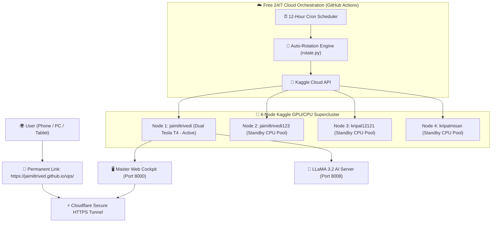

<div align="center">

# 🚀 Kaggle 24/7 Cloud Supercluster VPS
### *Turn Kaggle into a 100% Free 24/7 Cloud Supercomputer with Dual Tesla T4 GPUs, 120 GB RAM, and LLaMA 3.2 AI*

[](https://jaimiltrived.github.io/vps/)
[-76b900?style=for-the-badge&logo=nvidia&logoColor=white)](https://www.kaggle.com)
[](https://jaimiltrived.github.io/vps/)
[](https://github.com/jaimiltrived/vps/actions)
[](LICENSE)

<br/>

**[🌐 Open Live VPS Gateway](https://jaimiltrived.github.io/vps/)** • **[⚡ Quickstart](#-quickstart-guide)** • **[🤖 AI Endpoint (Port 8008)](#-built-in-llama-32-ai-server-port-8008)** • **[⭐ Star on GitHub](https://github.com/jaimiltrived/vps)**

</div>

---

## 🌟 Overview

**Kaggle VPS Supercluster** is an enterprise-grade cloud development environment and GPU computing cluster built entirely on top of free Kaggle instances. It breaks through the traditional 12-hour session limits and 30-minute idle disconnects by combining:

1. **4-Account Unified Supercluster:** Pools 4 Kaggle accounts to unlock **120 weekly GPU hours**, **16 CPU Cores**, and **120 GB RAM**.
2. **24/7 Cloud Auto-Rotation Engine:** A free **GitHub Actions** background daemon that rotates Kaggle GPU sessions every 12 hours automatically in the cloud—**even when your personal PC is powered completely off**.
3. **One Single Permanent Link:** Powered by **GitHub Pages** (`https://jaimiltrived.github.io/vps/`), ensuring your access address never changes.
4. **Built-in Local AI Engine:** Pre-installed **LLaMA 3.2** powered by Ollama running on custom port **`8008`** with full OpenAI-compatible API endpoints.

---

## ⚡ Supercluster Specifications

| Resource | Single Instance | **4-Node Supercluster Capacity** |
| :--- | :--- | :--- |
| **GPU Acceleration** | 2x NVIDIA Tesla T4 | **8x Tesla T4 GPUs (Rotating Pool)** |
| **GPU VRAM** | 16 GB × 2 = 32 GB | **Dual T4 Active with Layer Offloading** |
| **System Memory** | 31.35 GB RAM | **125.4 GB Combined RAM Pool** |
| **Compute Cores** | 4 vCPUs | **16 vCPUs Combined Pool** |
| **Storage Capacity**| 20 GB Scratch | **160 GB Unified Cluster Storage** |
| **AI LLM Engine** | - | **LLaMA 3.2 on Custom Port 8008** |
| **Uptime** | 12 Hours Max | **24/7 Continuous (Zero Local PC Required)** |
| **Cost** | Free | **$0.00 Forever** |

---

## 🏗️ System Architecture



---

## 🤖 Built-in LLaMA 3.2 AI Server (Port 8008)

The VPS automatically boots **Ollama** on custom port **`8008`** and loads **LLaMA 3.2** onto the Dual Tesla T4 GPUs with full OpenAI compatibility:

### Python Integration
```python
from openai import OpenAI

# Connect to your Kaggle VPS AI Endpoint
client = OpenAI(
    base_url="https://<YOUR_TUNNEL_URL>/v1",
    api_key="ollama"  # Required placeholder
)

response = client.chat.completions.create(
    model="llama3.2:1b",
    messages=[
        {"role": "system", "content": "You are my 24/7 personal cloud VPS AI assistant."},
        {"role": "user", "content": "Explain how distributed GPU clustering works in 2 sentences."}
    ]
)

print(response.choices[0].message.content)
```

### Direct cURL Request
```bash
curl -X POST https://<YOUR_TUNNEL_URL>/v1/chat/completions \
  -H "Content-Type: application/json" \
  -d '{
    "model": "llama3.2:1b",
    "messages": [{"role": "user", "content": "Hello LLaMA 3.2!"}]
  }'
```

---

## 🚀 Key Features

* **🖥️ Master Web Cockpit:** Single-page real-time dashboard featuring live GPU/CPU/RAM telemetry, active session countdown, and dark glassmorphic UI.
* **⌨️ Multi-Tab Web Terminal:** Full root `bash` shell powered by **Xterm.js** and Linux PTY websockets with color support and copy-paste.
* **📁 Cloud File Manager:** In-browser code editor (Ace Editor), directory browser, upload/download capabilities, and 1-click `.zip` backup downloads.
* **📦 1-Click App Store:** Instant launcher for **VS Code Server**, **JupyterLab**, **Ollama**, and **Streamlit**.
* **🛡️ Keep-Alive Heartbeat:** Built-in audio beacon and persistent websocket heartbeat to prevent Kaggle's 30-minute idle disconnects.
* **🌐 Single Permanent Address:** Always access via `https://jaimiltrived.github.io/vps/`.

---

## 🛠️ Quickstart Guide

### 1. Fork or Clone this Repository
```bash
git clone https://github.com/jaimiltrived/vps.git
cd vps
```

### 2. Configure Kaggle Credentials
Add your Kaggle account usernames and API tokens in `rotate.py` or as GitHub Repository Secrets:
* `KAGGLE_USERNAME`
* `KAGGLE_KEY`

### 3. Enable GitHub Pages & Actions
1. Go to **Settings $\to$ Pages** in your repo:
   - Source: **Deploy from a branch**
   - Branch: **`main`** $\to$ Click **Save**.
2. Go to the **Actions** tab:
   - Enable workflows to allow the 12-hour auto-rotation cron to run 24/7.

---

## 🤝 Contributing

Contributions, issues, and feature requests are welcome!
Feel free to check the [issues page](https://github.com/jaimiltrived/vps/issues).

---

## ⭐ Show Your Support

If this project helped you run a 24/7 free cloud VPS with Dual Tesla T4 GPUs, **please give it a ⭐ star on GitHub!** It helps more developers discover this project on Google and GitHub Trending!

<div align="center">

[](https://github.com/jaimiltrived/vps)

**Maintained by [@jaimiltrived](https://github.com/jaimiltrived)**

</div>
