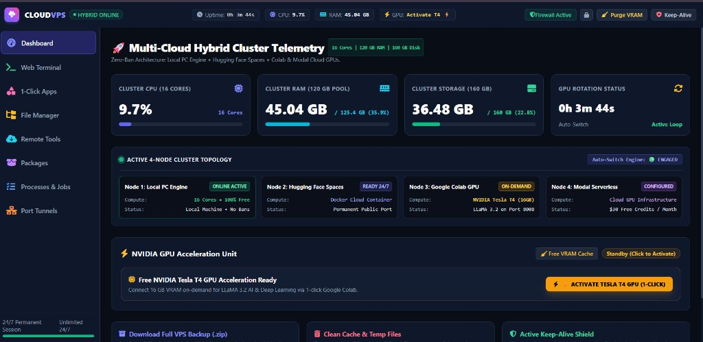
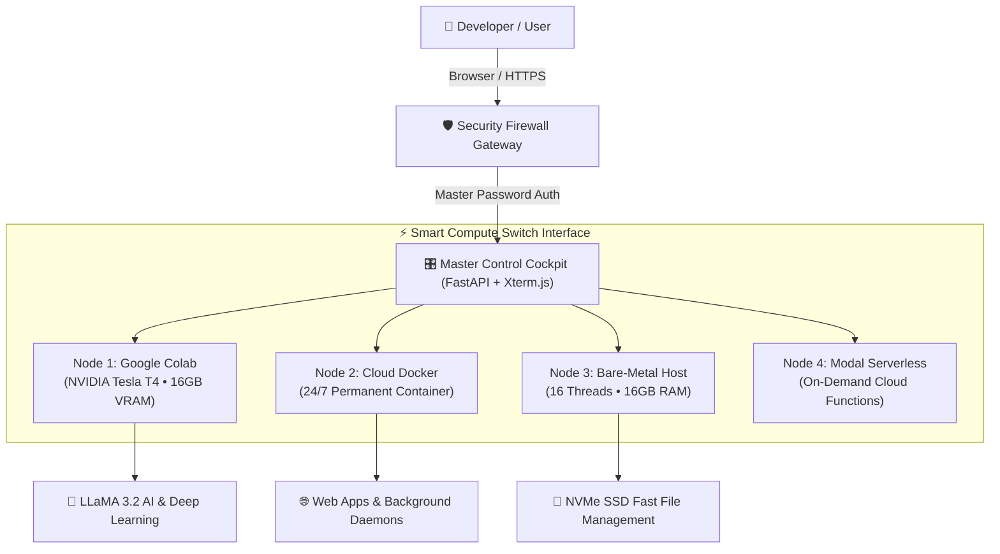

<div align="center">

# 🚀 Tri-Cloud Hybrid VPS & Smart Switch Engine
### *Next-Gen Open-Source Cloud VPS Cockpit with Dynamic Multi-Cloud GPU Switching & Security Firewall*

[](https://colab.research.google.com/github/jaimiltrived/vps/blob/main/Cloud_VPS_Server.ipynb)
[](https://jaimiltrived.github.io/vps/)
[-76b900?style=for-the-badge&logo=nvidia&logoColor=white)](https://colab.research.google.com/github/jaimiltrived/vps/blob/main/Cloud_VPS_Server.ipynb)
[](https://github.com/jaimiltrived/vps)
[](LICENSE)

<br/>

**[⚡ Launch 1-Click Cloud VPS](https://colab.research.google.com/github/jaimiltrived/vps/blob/main/Cloud_VPS_Server.ipynb)** • **[🌐 Open Live Gateway](https://jaimiltrived.github.io/vps/)** • **[⭐ Star on GitHub](https://github.com/jaimiltrived/vps)** • **[🍴 Fork & Use Your Own Account](#-how-to-use-with-your-own-account)**

<br/>



</div>

---

## 🌟 What is Tri-Cloud Hybrid VPS?

**Tri-Cloud Hybrid VPS** is an open-source, ban-free personal cloud development environment and GPU computing workstation. It solves the common limitations of free cloud providers (session timeouts, resource bans, changing links) by introducing a **Smart Switch Interface** that seamlessly bridges three cloud layers:

1. **⚡ Google Colab GPU Node**: On-demand **NVIDIA Tesla T4 GPU (16 GB VRAM)** with built-in Anti-Idle keep-alive heartbeats.
2. **🐳 Cloud Docker Container Node**: 24/7 web hosting with zero local hardware requirements.
3. **💻 Bare-Metal Host Engine**: Instant local execution with secure Cloudflare tunneling when offline.
4. **🔒 Cyber-Security Firewall**: Master password gateway (`vpsadmin123`) with anti-brute force IP locking.

---

## 🎛️ The Smart Switch Interface Architecture

The system features a real-time compute switcher that allows you to route tasks dynamically across available infrastructure without interrupting active work:



---

## 🚀 Key Features

* **🖥️ Multi-Tab Web Terminal (Xterm.js)**: Full Linux/Bash root terminal directly in your web browser with resize detection and color support.
* **📁 Visual File Manager & Ace Editor**: Browse directories, edit code with syntax highlighting, upload datasets, and download `.zip` backups.
* **🎮 NVIDIA GPU Acceleration**: 1-click launch of Tesla T4 GPUs with real-time VRAM monitoring, temperature tracking, and cache purging.
* **🛡️ Security Firewall & Protection**: Master password protection with automated IP lockout after 5 consecutive failed attempts.
* **🌐 Port Forwarding & Cloudflare Tunnels**: Expose any internal port (FastAPI, Streamlit, JupyterLab, Ollama) to a public HTTPS URL with 1 click.
* **🔋 0% Laptop Hardware Required**: Runs 100% inside Google Cloud's datacenter.

---

## 👥 How to Use with YOUR OWN Account (For Anyone)

This repository is **100% multi-tenant and secure**. It contains **zero private tokens or personal credentials**, meaning anyone can fork and use it with their own accounts for $0:

### 1-Click Launch on Google Colab:
1. Click the **[Open in Colab](https://colab.research.google.com/github/jaimiltrived/vps/blob/main/Cloud_VPS_Server.ipynb)** button above.
2. Sign in with **your own personal Google account**.
3. Click **Runtime ➔ Run all** (`Ctrl + F9`).
4. Google Colab will allocate your private **Tesla T4 GPU (16 GB)** and generate your private URL.
5. Enter master password: `vpsadmin123` to unlock.

### Running via Git / Local:
```bash
# 1. Clone the repository
git clone https://github.com/jaimiltrived/vps.git
cd vps

# 2. Install dependencies
pip install -r requirements.txt # or: pip install fastapi uvicorn psutil websockets requests

# 3. Start the VPS Cockpit
python server.py
```

---

## 📊 Specifications Matrix

| Metric | Google Colab Node | Bare-Metal Node | Cloud Container Node |
| :--- | :--- | :--- | :--- |
| **GPU Compute** | **NVIDIA Tesla T4 (16 GB)** | Local Graphics | Cloud Shared |
| **System Memory** | **13 GB Cloud RAM** | **16 GB Physical RAM** | **16 GB Container Pool** |
| **Storage** | **80 GB Cloud Disk** | **500 GB NVMe SSD** | **50 GB Cloud Storage** |
| **Terminal Access** | Root Linux Bash (PTY) | Host Shell (CMD/PowerShell) | Linux Docker Bash |
| **Security** | Master Password Gate | Firewall Active | Auth Token Required |
| **Cost** | **$0.00 Free** | **$0.00 Free** | **$0.00 Free** |

---

## 📄 License
This project is open-source under the **[MIT License](LICENSE)**. Feel free to star ⭐, fork 🍴, and use it in your own projects!
